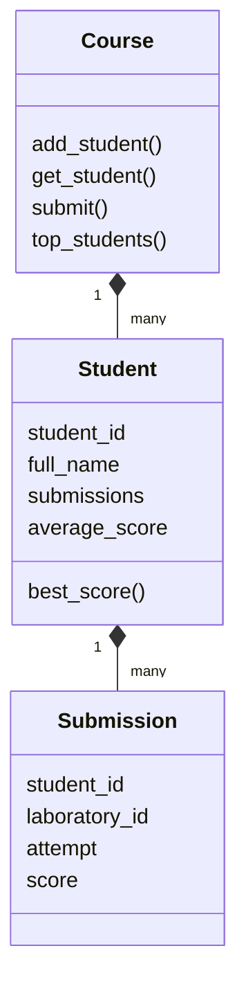
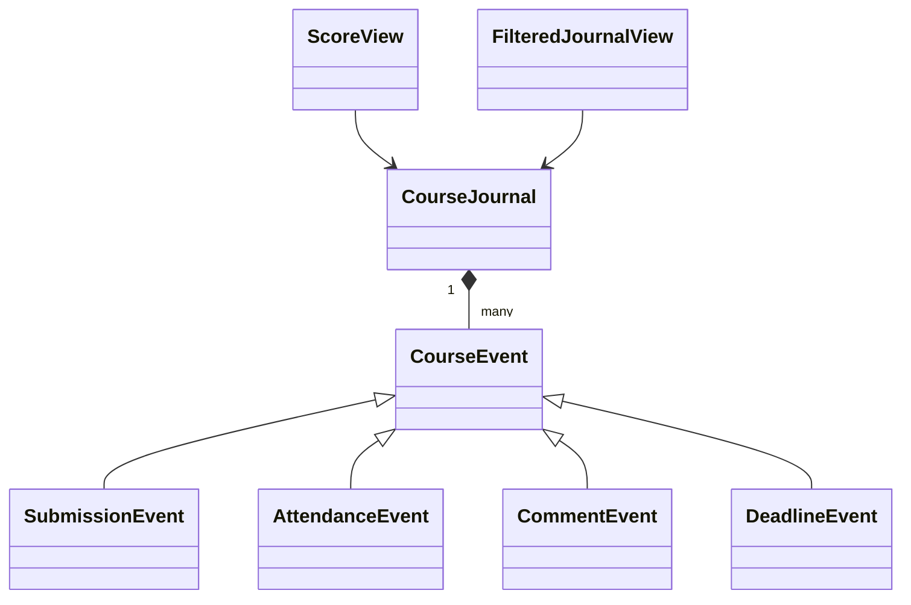

[← К лабораторной](../README.md) · [Исходный код](../tasks/) · [Отчет Word](REPORT.docx)

> Команды из отчета выполняются из папки `tasks` этой лабораторной.

# Лабораторная работа № 4

Итераторы генераторы и объектная модель

Выполнил:  
Группа:  
Проверил:  
Дата:  

## Цель работы

Изучить протокол итерации, ленивое выполнение генераторов и создание собственных типов. Реализовать диапазон, конвейер измерений, модель сдачи работ и расширяемый журнал курса.

## Ход работы

### 1 Среда и запуск

Проверка выполнена 24 ноября 2026 года в CPython 3.12.14, Windows 11. Используется только стандартная библиотека. Из папки lab_04 последовательно запускаются python task_1.py, …, python task_5.py. Все сценарии защищены условием if __name__ == '__main__'. Начиная с задания 2, публичные функции, классы и методы имеют аннотации и строки документации. Все пять файлов завершились с кодом 0.

### 2 Протокол итерации

В task_1.py iterator is values дал False, iter(iterator) is iterator — True. Три вызова next выдали 10, 20 и 30. Четвертый вызов вызвал StopIteration; он проверен с обработкой исключения, а строка без обработки оставлена комментарием.

consume создает iter(iterable), затем в while вызывает next и добавляет элемент в результат. StopIteration завершает цикл. В consume нет for, list(iterable) и готового накопления. Подтверждены результаты: список [10,20,30] → [10,20,30], кортеж (1,2) → [1,2], строка abc → ['a','b','c'], range(3) → [0,1,2], частично прочитанный итератор → [20,30], повторное чтение последнего → [].

my_enumerate лениво выдает пары индекса и значения, my_zip — пары из двух независимых итераторов до конца кратчайшего. Встроенные enumerate и zip для их реализации не использованы. Проверены список, строка, генератор и StepRange. Например, my_zip([1,2,3], 'ab') дал [(1,'a'),(2,'b')], а my_enumerate(StepRange(2,8,3)) — [(0,2),(1,5)].

Ответы на вопросы. iter итерируемого объекта должен вернуть итератор. После исчерпания next возбуждает StopIteration. Итератор возвращает себя из iter, поскольку он уже хранит состояние текущего обхода; новый список при iter создает новый объект обхода. Поэтому список можно читать повторно, а исчерпанный итератор останется пустым. my_zip может прочитать один лишний элемент первого источника, если второй закончился: это следствие последовательного вызова next.

### 3 Собственный диапазон

StepRange хранит только start, stop, step, а StepRangeIterator — текущее число и параметры одного обхода. Встроенный range для выдачи и хранения значений внутри этих классов не применяется. stop не включается. Нулевой step отклоняется с ValueError.

Таблица 1 — Проверки диапазона

| Параметры | Ожидалось | Получено |
| --- | --- | --- |
| 2, 11, 3 | [2,5,8] | [2,5,8] |
| 0, 5, 1 | [0,1,2,3,4] | [0,1,2,3,4] |
| 5, 0, −1 | [5,4,3,2,1] | [5,4,3,2,1] |
| 0, 0, 1 | [] | [] |
| 0, 5, −1 | [] | [] |
| 0, 5, 0 | ValueError | ValueError |

Для StepRange(2,11,3) созданы независимые first и second. Состояния после каждого вызова представлены в таблице 2; current означает следующее число, которое выдаст итератор.

Таблица 2 — Состояния двух итераторов

| Шаг | Результат next | first.current | second.current |
| --- | --- | --- | --- |
| Начало | — | 2 | 2 |
| next(first) | 2 | 5 | 2 |
| next(second) | 2 | 5 | 5 |
| next(first) | 5 | 8 | 5 |
| next(second) | 5 | 8 | 8 |

```text
numbers -> StepRange(2, 11, 3)
first  -> Iterator(current=8, stop=11, step=3)
second -> Iterator(current=8, stop=11, step=3)
```

Рисунок 1 — Независимые объекты обхода

len вычисляется формулой округления числа шагов вверх, без перебора. in проверяет границы и кратность разности шагу. Для StepRange(0,1000000,1) поиск 999999 явным обходом потребовал 1000000 сравнений, а __contains__ — двух сравнений границ, остатка от деления и сравнения с нулем. Для машинных целых это O(n) против O(1). Проверены положительный и отрицательный шаги, равные границы и значение stop.

Ответы на вопросы. Раздельное состояние позволяет одновременно обходить один диапазон несколькими циклами. Если возвращать один общий изменяемый итератор, обходы будут сдвигать друг другу current, а повторный обход начнется с оставшейся позиции. Диапазон и каждый итератор хранят постоянное число полей, то есть O(1) памяти относительно количества элементов в обычной модели оценки. Очень большие целые сами требуют памяти под свои разряды.

### 4 Генераторы и ленивый конвейер

Конвейер состоит из read_measurements, filter_range и moving_average. Пустые строки отбрасываются, числа фильтруются в диапазоне [0,20], затем вычисляется среднее окна из трех элементов. deque хранит только последние элементы и позволяет удалять слева без сдвига всего списка. Текущее суммарное значение обновляется при добавлении и удалении элемента.

Для исходных строк после фильтрации остаются 10.0, 12.5, 11.5, 13.0, 9.5. Первые два next дали 11.333333333333334 и 12.333333333333334; список остатка — [11.333333333333334]. Повторный обход исчерпанного генератора дал [], новый конвейер — все три значения. Исходный raw_lines не изменен. Нулевое окно вызывает ValueError при начале обхода генератора, а не при одном создании объекта генератора.

Включения дали квадраты четных [4,16,36,64,100,144,196,256,324,400], множество длин {3,4,5}, словарь квадратов для 1..10. Генераторное выражение для суммы квадратов 0..99999 дало 333328333350000. Включение сразу строит коллекцию, генераторное выражение вычисляет элементы по запросу.

take не считывает лишний элемент после n; drop пропускает n элементов; batch выдает список не больше size элементов, включая неполный последний пакет. Для batch(take(3, drop(1, pipeline(raw_lines))), 2) получен один пакет [12.333333333333334,11.333333333333334]. Проверены take(0), слишком большой drop, последний неполный пакет и недопустимые отрицательные параметры.

Для 100000 исходных значений выполнены два отдельных сеанса tracemalloc. Одинаковые данные и одинаковое итоговое суммирование обеспечили сравнимость. Ленивый конвейер дал пик 2750 байт, вариант с отдельным списком на каждом этапе — 12255696 байт. Итоговые суммы совпали. Эти размеры относятся к данному запуску. Ленивый вариант требует O(w) памяти окна, материализованный — O(n); оба выполняют O(n) операций. Источник строк также ленивый, поэтому исходный список из 100000 строк не скрыт за границами измерения.

### 5 Студенты попытки и курс

Submission — dataclass с полями student_id, laboratory_id, attempt, score и comment. __post_init__ проверяет непустые идентификаторы, положительный номер и конечный балл 0..100. frozen=True не позволяет менять запись через полученный снаружи объект. Равенство dataclass сравнивает содержимое.

Student хранит приватный по соглашению список _submissions, выдает кортеж через property submissions, вычисляет average_score и best_score. Добавление чужой попытки или повтора номера одной работы отклоняется. Пустая история дает None для оценок. from_full_name использует classmethod и нормализует пробелы; valid_id — staticmethod для проверки идентификатора без пробелов.

Course хранит студентов в словаре, не допускает повторов, ищет по ключу и автоматически назначает следующий номер попытки. top_students возвращает студентов с оценками по убыванию среднего и не меняет порядок внутренней истории. len, iter и in работают через специальные методы. Диаграмма модели приведена на рисунке 2.



Рисунок 2 — Композиция курса студентов и попыток

Примеры запуска: len(anna) = 2, average_score = 80, best_score('lab_01') = 90, len(course) = 2, 's1' in course — True. Два итератора истории независимо выдали первую попытку. Сортировка через sorted по (attempt,score) и отдельно по score не изменила tuple исходных записей. Неверные идентификатор, номер и балл отклонены.

Композиция описывает отношение «курс содержит студентов, студент содержит попытки». Наследование Student от Submission означало бы «студент является попыткой», что неверно по смыслу. Классы имеют отдельные инварианты и обязанности.

### 6 Расширяемый журнал

CourseEvent — абстрактный базовый класс с абстрактным student_id и describe, общим временем created_at. Наследники SubmissionEvent, AttendanceEvent и CommentEvent реализуют описание своих данных. DeadlineEvent добавлен без изменения render_timeline: функция просто вызывает describe у всех событий. Это полиморфизм по общему интерфейсу.



Рисунок 3 — События журнала и ленивые представления

Созданы три студента, по три посещения и комментария, четыре сдачи и один дедлайн — всего 11 событий. Анна имеет две попытки одной работы с баллами 70 и 90. Выборка s1 содержит пять событий, выборка SubmissionEvent — четыре. Срез journal[:2] создает новый список; его очистка не изменила журнал. Изменение словаря summary также не изменило внутренние данные.

ScoreView хранит ссылку на журнал и при каждом iter создает новый генератор баллов. Два обхода дали [70,90,80,100], среднее 85. FilteredJournalView с is_anna и с lambda дал одинаковые пять событий; повторный обход сохранил результат. Временная шкала выведена для всех 11 событий, точное время зависит от запуска.

Наследование используется там, где события являются разновидностями CourseEvent. Композиция хранит события внутри CourseJournal и попытку внутри SubmissionEvent. Протоколы __iter__, __len__ и __getitem__ делают собственные объекты совместимыми с for, list, len, индексами и срезами. Представления не копируют весь журнал и расширяют способы его чтения.

## Вывод

Итерируемый объект описывает источник данных, а итератор хранит конкретную позицию обхода. Генераторы позволяют обрабатывать данные без промежуточной материализации. Композиция отражает состав объектов, наследование — общий интерфейс разновидностей, а специальные методы связывают собственные классы со встроенными операциями Python. Все протоколы, классы и генераторы подтверждены запускаемыми сценариями.

## Источники

1. [Задание лабораторной 4](https://github.com/itmo-faculty-applied-informatics/fai_topit_fundamentals_of_programming/blob/main/labs/lab_04_iterators_generators_oop.md).
2. [Оформление ИТМО](https://student.itmo.ru/files/1314).
3. [Оформление Markdown](https://gist.github.com/Jekins/2bf2d0638163f1294637).


## Приложение Исходный код

### task_1.py

```python
"""Изучаем iter, next и простые аналоги enumerate и zip."""
from task_2 import StepRange


def consume(iterable) -> list:
    """Собираем элементы вручную, пока next не вызовет StopIteration."""
    iterator = iter(iterable)
    result = []
    while True:
        try:
            value = next(iterator)
        except StopIteration:
            break
        result.append(value)
    return result


def my_enumerate(iterable, start=0):
    """Лениво выдаем пары индекс и значение."""
    index = start
    for value in iterable:
        yield index, value
        index += 1


def my_zip(first, second):
    """Останавливаемся при исчерпании любого источника."""
    left = iter(first)
    right = iter(second)
    while True:
        try:
            a = next(left)
            b = next(right)
        except StopIteration:
            return
        yield a, b


def main():
    values = [10, 20, 30]
    iterator = iter(values)
    print(iterator is values)
    print(iter(iterator) is iterator)
    print(next(iterator), next(iterator), next(iterator))
    # next(iterator)  # StopIteration: четвертого элемента нет.
    try:
        next(iterator)
    except StopIteration:
        print('Четвертый next: StopIteration')
    assert consume(values) == [10, 20, 30]
    assert consume((1, 2)) == [1, 2]
    assert consume('abc') == ['a', 'b', 'c']
    assert consume(range(3)) == [0, 1, 2]
    partial = iter(values)
    next(partial)
    assert consume(partial) == [20, 30]
    assert consume(partial) == []
    print('Повторный список:', consume(values), consume(values))
    print('Исчерпанный итератор:', consume(partial))
    assert list(my_enumerate([10, 20], 1)) == [(1, 10), (2, 20)]
    assert list(my_enumerate('ab')) == [(0, 'a'), (1, 'b')]
    assert list(my_enumerate(x * 2 for x in [1, 2])) == [(0, 2), (1, 4)]
    assert list(my_enumerate(StepRange(2, 8, 3))) == [(0, 2), (1, 5)]
    assert list(my_zip([1, 2, 3], 'ab')) == [(1, 'a'), (2, 'b')]
    assert list(my_zip('ab', 'XY')) == [('a', 'X'), ('b', 'Y')]
    assert list(my_zip((x for x in [1, 2]), 'ab')) == [(1, 'a'), (2, 'b')]
    assert list(my_zip(StepRange(0, 3, 1), 'ab')) == [(0, 'a'), (1, 'b')]
    assert list(my_zip([], 'ab')) == []
    print('consume, my_enumerate, my_zip: проверки пройдены')


if __name__ == '__main__':
    main()
```

### task_2.py

```python
"""Повторно обходимый диапазон без хранения списка чисел."""


class StepRangeIterator:
    """Хранит состояние одного обхода."""

    def __init__(self, start: int, stop: int, step: int) -> None:
        """Запоминаем текущее число, границу и шаг."""
        self.current = start
        self.stop = stop
        self.step = step

    def __iter__(self) -> 'StepRangeIterator':
        """Итератор возвращает себя."""
        return self

    def __next__(self) -> int:
        """Выдаем число и сдвигаем текущее значение."""
        if self.step > 0 and self.current >= self.stop:
            raise StopIteration
        if self.step < 0 and self.current <= self.stop:
            raise StopIteration
        value = self.current
        self.current += self.step
        return value


class StepRange:
    """Хранит только start, stop и ненулевой step."""

    def __init__(self, start: int, stop: int, step: int) -> None:
        """Создаем диапазон, не включая stop."""
        if step == 0:
            raise ValueError('Шаг не может быть нулевым')
        self.start = start
        self.stop = stop
        self.step = step

    def __iter__(self) -> StepRangeIterator:
        """Для каждого обхода создаем независимый итератор."""
        return StepRangeIterator(self.start, self.stop, self.step)

    def __len__(self) -> int:
        """Вычисляем число элементов без перебора."""
        if self.step > 0:
            distance = self.stop - self.start
        else:
            distance = self.start - self.stop
        if distance <= 0:
            return 0
        step = abs(self.step)
        return (distance + step - 1) // step

    def __contains__(self, value: int) -> bool:
        """Проверяем границы и кратность шага."""
        if not isinstance(value, int):
            return False
        if self.step > 0:
            inside = self.start <= value < self.stop
        else:
            inside = self.stop < value <= self.start
        return inside and (value - self.start) % self.step == 0

    def __repr__(self) -> str:
        """Показываем параметры диапазона."""
        return f'StepRange({self.start}, {self.stop}, {self.step})'


def main() -> None:
    """Проверяем шаги, границы и независимость обходов."""
    for start, stop, step, expected in [
        (2, 11, 3, [2, 5, 8]), (0, 5, 1, [0, 1, 2, 3, 4]),
        (5, 0, -1, [5, 4, 3, 2, 1]), (0, 0, 1, []), (0, 5, -1, []),
    ]:
        numbers = StepRange(start, stop, step)
        assert list(numbers) == expected
        assert len(numbers) == len(expected)
        assert list(numbers) == expected
        print(repr(numbers), list(numbers), len(numbers))
    try:
        StepRange(0, 5, 0)
    except ValueError as error:
        print(type(error).__name__, error)
    else:
        raise AssertionError('Нулевой шаг должен отклоняться')
    numbers = StepRange(2, 11, 3)
    first = iter(numbers)
    second = iter(numbers)
    for iterator in [first, second, first, second]:
        print('Выдано:', next(iterator), 'состояние:', first.current, second.current)
    assert first.current == second.current == 8
    assert 5 in numbers and 6 not in numbers and 11 not in numbers
    assert 3 in StepRange(5, 0, -1)
    large = StepRange(0, 1_000_000, 1)
    target = 999_999
    comparisons = 0
    for value in large:
        comparisons += 1
        if value == target:
            break
    print('Перебор:', comparisons, 'проверок; contains:', target in large)
    print('contains: две проверки границ, остаток от деления и сравнение с 0')
    assert comparisons == 1_000_000


if __name__ == '__main__':
    main()
```

### task_3.py

```python
"""Ленивый конвейер измерений и сравнение памяти."""
import gc
import tracemalloc
from collections import deque
from collections.abc import Iterable, Iterator


def read_measurements(lines: Iterable[str]) -> Iterator[float]:
    """Преобразуем непустые строки в числа."""
    for line in lines:
        if line.strip() != '':
            yield float(line)


def filter_range(values: Iterable[float], minimum: float,
                 maximum: float) -> Iterator[float]:
    """Оставляем числа из закрытого диапазона."""
    if minimum > maximum:
        raise ValueError('Минимум больше максимума')
    for value in values:
        if minimum <= value <= maximum:
            yield value


def moving_average(values: Iterable[float], window_size: int) -> Iterator[float]:
    """Храним только последнее окно и выдаем его среднее."""
    if window_size <= 0:
        raise ValueError('Размер окна должен быть положительным')
    window = deque()
    total = 0.0
    for value in values:
        window.append(value)
        total += value
        if len(window) > window_size:
            total -= window.popleft()
        if len(window) == window_size:
            yield total / window_size


def take(n: int, iterable: Iterable) -> Iterator:
    """Выдаем не больше n элементов, не читая лишний."""
    if n < 0:
        raise ValueError('n не может быть отрицательным')
    iterator = iter(iterable)
    for _ in range(n):
        try:
            value = next(iterator)
        except StopIteration:
            return
        yield value


def drop(n: int, iterable: Iterable) -> Iterator:
    """Пропускаем первые n элементов."""
    if n < 0:
        raise ValueError('n не может быть отрицательным')
    iterator = iter(iterable)
    for _ in range(n):
        try:
            next(iterator)
        except StopIteration:
            return
    yield from iterator


def batch(iterable: Iterable, size: int) -> Iterator[list]:
    """Выдаем пакеты, последний может быть неполным."""
    if size <= 0:
        raise ValueError('Размер пакета должен быть положительным')
    packet = []
    for value in iterable:
        packet.append(value)
        if len(packet) == size:
            yield packet
            packet = []
    if packet:
        yield packet


def pipeline(lines: Iterable[str]) -> Iterator[float]:
    """Соединяем три генератора без промежуточных списков."""
    numbers = read_measurements(lines)
    filtered = filter_range(numbers, 0, 20)
    return moving_average(filtered, 3)


def memory_peak(lazy: bool) -> tuple[int, float]:
    """Сравниваем одинаковые данные и одинаковый итог."""
    gc.collect()
    tracemalloc.start()
    lines = (str(i % 20) for i in range(100_000))
    if lazy:
        result = pipeline(lines)
    else:
        raw = list(lines)
        numbers = list(read_measurements(raw))
        filtered = list(filter_range(numbers, 0, 20))
        result = list(moving_average(filtered, 3))
    total = 0.0
    for value in result:
        total += value
    current, peak = tracemalloc.get_traced_memory()
    tracemalloc.stop()
    return peak, total


def main() -> None:
    """Проверяем ленивость, исчерпание, включения и память."""
    raw_lines = ['10.0', '', '12.5', '100.0', '11.5', '13.0', '9.5']
    original = raw_lines.copy()
    stream = pipeline(raw_lines)
    print('Первые два:', next(stream), next(stream))
    print('Остаток:', list(stream))
    assert list(stream) == []
    assert list(pipeline(raw_lines)) == [34 / 3, 37 / 3, 34 / 3]
    assert raw_lines == original
    squares = [x * x for x in range(1, 21) if x % 2 == 0]
    lengths = {len(line) for line in raw_lines if line != ''}
    mapping = {x: x * x for x in range(1, 11)}
    total = sum(x * x for x in range(100_000))
    print('Включения:', squares, lengths, mapping)
    print('Сумма квадратов:', total)
    packets = list(batch(take(3, drop(1, pipeline(raw_lines))), 2))
    print('Пакеты:', packets)
    assert packets == [[37 / 3, 34 / 3]]
    assert list(take(0, range(5))) == []
    assert list(drop(10, range(3))) == []
    assert list(batch(range(5), 2)) == [[0, 1], [2, 3], [4]]
    for generator in [moving_average([], 0), batch([], 0), take(-1, []), drop(-1, [])]:
        try:
            next(generator)
        except ValueError as error:
            print('Проверка ошибки:', error)
        else:
            raise AssertionError('Ожидался ValueError')
    lazy_peak, lazy_total = memory_peak(True)
    list_peak, list_total = memory_peak(False)
    assert lazy_total == list_total
    assert lazy_peak < list_peak
    print('Пики, байт: lazy =', lazy_peak, 'list =', list_peak)


if __name__ == '__main__':
    main()
```

### task_4.py

```python
"""Студенты, попытки сдачи и курс."""
from dataclasses import dataclass
from collections.abc import Iterator
from math import isfinite


@dataclass(frozen=True)
class Submission:
    """Неизменяемая запись одной попытки."""
    student_id: str
    laboratory_id: str
    attempt: int
    score: float
    comment: str = ''

    def __post_init__(self) -> None:
        """Проверяем идентификаторы, номер и диапазон балла."""
        if not self.student_id.strip() or not self.laboratory_id.strip():
            raise ValueError('Идентификаторы не могут быть пустыми')
        if self.attempt <= 0:
            raise ValueError('Номер попытки должен быть положительным')
        if not isfinite(self.score) or not 0 <= self.score <= 100:
            raise ValueError('Балл должен быть от 0 до 100')


class Student:
    """Хранит данные студента и его попытки."""

    def __init__(self, student_id: str, full_name: str) -> None:
        """Создаем студента с пустой историей."""
        if not self.valid_id(student_id) or not full_name.strip():
            raise ValueError('Неверный идентификатор или пустое имя')
        self.student_id = student_id
        self.full_name = full_name
        self._submissions = []

    @staticmethod
    def valid_id(student_id: str) -> bool:
        """Идентификатор непустой и не содержит пробельных символов."""
        return bool(student_id) and len(student_id.split()) == 1 and not any(
            symbol.isspace() for symbol in student_id)

    @classmethod
    def from_full_name(cls, student_id: str, full_name: str) -> 'Student':
        """Убираем лишние пробелы в имени."""
        return cls(student_id, ' '.join(full_name.split()))

    def add_submission(self, submission: Submission) -> None:
        """Добавляем только попытку данного студента без дубля номера."""
        if submission.student_id != self.student_id:
            raise ValueError('Попытка принадлежит другому студенту')
        for old in self._submissions:
            if (old.laboratory_id == submission.laboratory_id
                    and old.attempt == submission.attempt):
                raise ValueError('Попытка с таким номером уже есть')
        self._submissions.append(submission)

    @property
    def submissions(self) -> tuple[Submission, ...]:
        """Выдаем кортеж вместо внутреннего изменяемого списка."""
        return tuple(self._submissions)

    @property
    def average_score(self) -> float | None:
        """Среднее всех попыток или None, если попыток нет."""
        if not self._submissions:
            return None
        total = 0
        for submission in self._submissions:
            total += submission.score
        return total / len(self._submissions)

    def best_score(self, laboratory_id: str) -> float | None:
        """Лучший балл указанной работы или None."""
        best = None
        for submission in self._submissions:
            if submission.laboratory_id == laboratory_id:
                if best is None or submission.score > best:
                    best = submission.score
        return best

    def __len__(self) -> int:
        """Число попыток."""
        return len(self._submissions)

    def __iter__(self) -> Iterator[Submission]:
        """Независимый обход истории."""
        return iter(self._submissions)

    def __str__(self) -> str:
        """Представление для пользователя."""
        return f'{self.full_name}: {len(self)} попыток'

    def __repr__(self) -> str:
        """Представление для отладки."""
        return f'Student({self.student_id!r}, {self.full_name!r})'


class Course:
    """Хранит студентов и управляет сдачей работ."""

    def __init__(self) -> None:
        """Создаем пустой курс."""
        self._students = {}

    def add_student(self, student: Student) -> None:
        """Регистрируем уникальный идентификатор."""
        if student.student_id in self._students:
            raise ValueError('Студент уже зарегистрирован')
        self._students[student.student_id] = student

    def get_student(self, student_id: str) -> Student:
        """Находим студента или вызываем KeyError."""
        return self._students[student_id]

    def submit(self, student_id: str, laboratory_id: str,
               score: float, comment: str = '') -> Submission:
        """Автоматически назначаем следующий номер попытки."""
        student = self.get_student(student_id)
        attempt = 1
        for old in student:
            if old.laboratory_id == laboratory_id:
                attempt = max(attempt, old.attempt + 1)
        submission = Submission(student_id, laboratory_id, attempt, score, comment)
        student.add_submission(submission)
        return submission

    def top_students(self, limit: int = 3) -> list[Student]:
        """Возвращаем студентов с оценками по убыванию среднего."""
        if limit < 0:
            raise ValueError('Лимит не может быть отрицательным')
        students = []
        for student in self:
            if student.average_score is not None:
                students.append(student)
        return sorted(students, key=lambda s: s.average_score, reverse=True)[:limit]

    def __contains__(self, student_id: str) -> bool:
        """Проверяем наличие идентификатора."""
        return student_id in self._students

    def __len__(self) -> int:
        """Число зарегистрированных студентов."""
        return len(self._students)

    def __iter__(self) -> Iterator[Student]:
        """Обходим студентов в порядке регистрации."""
        return iter(self._students.values())


def main() -> None:
    """Проверяем свойства, конструкторы и стандартные операции."""
    course = Course()
    anna = Student.from_full_name('s1', '  Анна   Смирнова ')
    course.add_student(anna)
    course.add_student(Student('s2', 'Борис Иванов'))
    first = course.submit('s1', 'lab_01', 70)
    second = course.submit('s1', 'lab_01', 90)
    course.submit('s2', 'lab_01', 95)
    assert anna.full_name == 'Анна Смирнова'
    assert first == Submission('s1', 'lab_01', 1, 70)
    assert len(anna) == 2 and anna.average_score == 80
    assert anna.best_score('lab_01') == 90
    assert anna.best_score('unknown') is None
    assert isinstance(anna.submissions, tuple)
    assert len(course) == 2 and 's1' in course
    a = iter(anna)
    b = iter(anna)
    assert next(a) is next(b) is first
    before = anna.submissions
    ordered = sorted(anna, key=lambda s: (s.attempt, s.score))
    by_score = sorted(anna, key=lambda s: s.score, reverse=True)
    assert anna.submissions == before
    assert by_score[0] is second
    print(str(anna), repr(anna), ordered, by_score)
    print('Курс:', len(course), 's1' in course, list(course))
    print('Рейтинг:', course.top_students())
    for bad in [('s1', '', 1, 50), ('s1', 'lab', 0, 50), ('s1', 'lab', 1, 101)]:
        try:
            Submission(*bad)
        except ValueError as error:
            print('Отклонено:', error)
        else:
            raise AssertionError('Неверная попытка принята')
    print('Модель: проверки пройдены')


if __name__ == '__main__':
    main()
```

### task_5.py

```python
"""Журнал курса: наследование, композиция и протоколы."""
from abc import ABC, abstractmethod
from collections.abc import Callable, Iterable, Iterator
from datetime import datetime
from task_4 import Course, Student, Submission


class CourseEvent(ABC):
    """Общий интерфейс события курса."""

    def __init__(self, student_id: str) -> None:
        """Запоминаем студента и время создания."""
        self._student_id = student_id
        self.created_at = datetime.now()

    @property
    @abstractmethod
    def student_id(self) -> str:
        """Идентификатор студента события."""
        raise NotImplementedError

    @abstractmethod
    def describe(self) -> str:
        """Описание события для временной шкалы."""
        raise NotImplementedError


class SubmissionEvent(CourseEvent):
    """Событие содержит запись попытки сдачи."""

    def __init__(self, submission: Submission) -> None:
        """Сохраняем попытку как составную часть события."""
        super().__init__(submission.student_id)
        self.submission = submission

    @property
    def student_id(self) -> str:
        """Возвращаем идентификатор студента."""
        return self._student_id

    def describe(self) -> str:
        """Описываем работу, попытку и балл."""
        s = self.submission
        return f'{s.student_id}: {s.laboratory_id}, попытка {s.attempt}, балл {s.score}'


class AttendanceEvent(CourseEvent):
    """Событие посещения занятия."""

    def __init__(self, student_id: str, lesson: str) -> None:
        """Запоминаем название посещенного занятия."""
        super().__init__(student_id)
        self.lesson = lesson

    @property
    def student_id(self) -> str:
        """Возвращаем идентификатор студента."""
        return self._student_id

    def describe(self) -> str:
        """Описываем посещение."""
        return f'{self.student_id}: посетил занятие {self.lesson}'


class CommentEvent(CourseEvent):
    """Текстовая обратная связь."""

    def __init__(self, student_id: str, text: str) -> None:
        """Запоминаем текст отзыва."""
        super().__init__(student_id)
        self.text = text

    @property
    def student_id(self) -> str:
        """Возвращаем идентификатор студента."""
        return self._student_id

    def describe(self) -> str:
        """Описываем отзыв."""
        return f'{self.student_id}: отзыв — {self.text}'


class DeadlineEvent(CourseEvent):
    """Новый вид события, не требующий изменения render_timeline."""

    def __init__(self, student_id: str, deadline: str) -> None:
        """Запоминаем срок сдачи."""
        super().__init__(student_id)
        self.deadline = deadline

    @property
    def student_id(self) -> str:
        """Возвращаем идентификатор студента."""
        return self._student_id

    def describe(self) -> str:
        """Описываем срок."""
        return f'{self.student_id}: срок сдачи {self.deadline}'


class CourseJournal:
    """Упорядоченная коллекция событий."""

    def __init__(self) -> None:
        """Создаем внутренний список."""
        self._events = []

    def add(self, event: CourseEvent) -> None:
        """Добавляем событие в конец."""
        self._events.append(event)

    def __len__(self) -> int:
        """Число событий."""
        return len(self._events)

    def __iter__(self) -> Iterator[CourseEvent]:
        """Независимый последовательный обход."""
        return iter(self._events)

    def __getitem__(self, index: int | slice) -> CourseEvent | list[CourseEvent]:
        """Поддерживаем индекс и срез; срез создает новый список."""
        return self._events[index]

    def __str__(self) -> str:
        """Краткая информация для пользователя."""
        return f'Журнал: {len(self)} событий'

    def __repr__(self) -> str:
        """Краткая информация для отладки."""
        return f'CourseJournal(events={len(self)})'

    def events_for_student(self, student_id: str) -> Iterator[CourseEvent]:
        """Ленивая выборка по студенту."""
        for event in self:
            if event.student_id == student_id:
                yield event

    def events_by_type(self, event_type: type) -> Iterator[CourseEvent]:
        """Ленивая выборка по типу."""
        for event in self:
            if isinstance(event, event_type):
                yield event

    def summary(self) -> dict:
        """Возвращаем новый словарь счетчиков."""
        counts = {}
        for event in self:
            name = type(event).__name__
            counts[name] = counts.get(name, 0) + 1
        return counts


def render_timeline(events: Iterable[CourseEvent]) -> str:
    """Работаем с общим интерфейсом describe без проверки типов."""
    lines = []
    for event in events:
        lines.append(event.created_at.isoformat(timespec='seconds') + ' ' + event.describe())
    return '\n'.join(lines)


class ScoreView:
    """Повторно обходимый ленивый вид только баллов сдач."""

    def __init__(self, journal: CourseJournal) -> None:
        """Сохраняем ссылку на журнал, не копируем события."""
        self.journal = journal

    def __iter__(self) -> Iterator[float]:
        """Новый генератор при каждом обходе."""
        for event in self.journal:
            if isinstance(event, SubmissionEvent):
                yield event.submission.score


class FilteredJournalView:
    """Ленивая выборка по переданному условию."""

    def __init__(self, journal: CourseJournal,
                 predicate: Callable[[CourseEvent], bool]) -> None:
        """Сохраняем журнал и функцию условия."""
        self.journal = journal
        self.predicate = predicate

    def __iter__(self) -> Iterator[CourseEvent]:
        """Повторный обход снова проверяет условие."""
        for event in self.journal:
            if self.predicate(event):
                yield event


def is_anna(event: CourseEvent) -> bool:
    """Именованный предикат для студента s1."""
    return event.student_id == 's1'


def main() -> None:
    """Создаем трех студентов и одиннадцать событий."""
    course = Course()
    for sid, name in [('s1', 'Анна'), ('s2', 'Борис'), ('s3', 'Дарья')]:
        course.add_student(Student(sid, name))
    journal = CourseJournal()
    for sid in ['s1', 's2', 's3']:
        journal.add(AttendanceEvent(sid, 'Python'))
        journal.add(CommentEvent(sid, 'Продолжайте работу'))
    for sid, score in [('s1', 70), ('s1', 90), ('s2', 80), ('s3', 100)]:
        journal.add(SubmissionEvent(course.submit(sid, 'lab_01', score)))
    journal.add(DeadlineEvent('s1', '2026-12-01'))
    assert len(course) == 3 and len(journal) == 11
    print(str(journal), repr(journal))
    print(render_timeline(journal))
    print('Студент s1:', render_timeline(journal.events_for_student('s1')))
    assert len(list(journal.events_for_student('s1'))) == 5
    assert len(list(journal.events_by_type(SubmissionEvent))) == 4
    part = journal[:2]
    part.clear()
    assert len(journal) == 11
    assert journal[0] is list(journal)[0]
    counts = journal.summary()
    counts.clear()
    assert journal.summary()['SubmissionEvent'] == 4
    scores = ScoreView(journal)
    assert list(scores) == list(scores) == [70, 90, 80, 100]
    print('Баллы:', list(scores), 'среднее:', sum(scores) / len(list(scores)))
    named = FilteredJournalView(journal, is_anna)
    unnamed = FilteredJournalView(journal, lambda event: event.student_id == 's1')
    assert list(named) == list(named) == list(unnamed)
    print('Журнал и представления: проверки пройдены')


if __name__ == '__main__':
    main()
```

