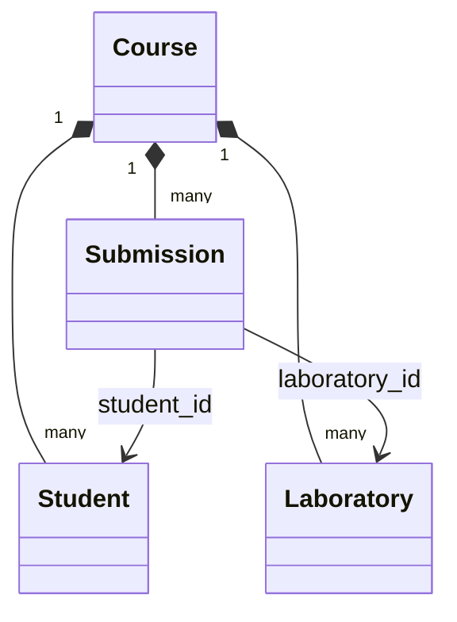
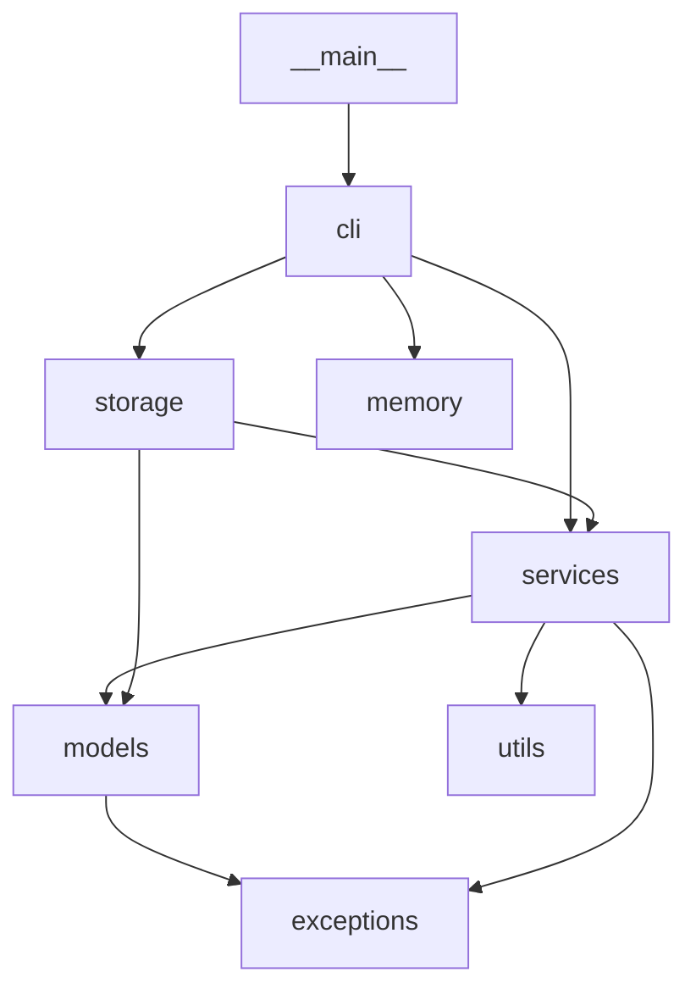
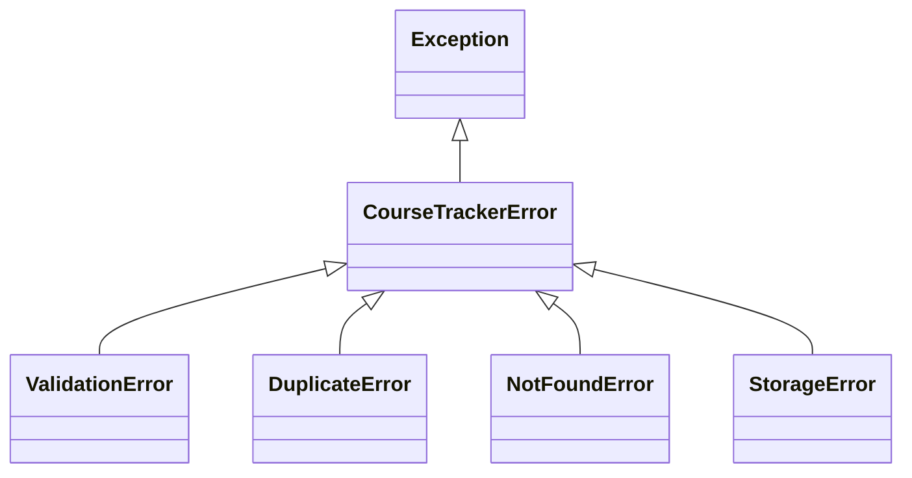

# Лабораторная работа № 5

Надежный учебный проект CourseTracker

Выполнил:  
Группа:  
Проверил:  
Дата:  

## Цель работы

Объединить темы курса в консольном приложении CourseTracker: модели данных, коллекции, алгоритмы, генераторы, исключения, файлы, копирование, журналирование и автоматические тесты.

## Ход работы

### 1 Результат и запуск

Разработано одно многофайловое приложение, запускаемое из lab_05 командой python -m course_tracker. Использованы CPython 3.12.14, Windows 11 и pytest 9.2.0. Проверка выполнена 24 ноября 2026 года. Само приложение не требует сторонних библиотек. Установка pytest, создание окружения, команды, форматы данных и ограничения описаны в README.md.

Приложение регистрирует студентов и работы, сохраняет несколько попыток, назначает их номера и время, меняет статусы, строит отчеты и рейтинг, импортирует CSV, экспортирует JSON и CSV, сохраняет состояние между запусками. CLI использует shlex.split, match/case и отдельные обработчики, а вычисления выполняются в сервисном слое.

### 2 Модель и архитектура

Student хранит идентификатор, полное имя, группу, дату регистрации и активность. Laboratory хранит идентификатор, название, описание, положительный максимум, дату дедлайна и множество нормализованных тегов. Submission хранит ссылки по идентификаторам, положительный номер, конечный балл, дату и время, комментарий, статус и максимум работы. Course проверяет существование связанных объектов и уникальность идентификаторов.



Рисунок 1 — Классы CourseTracker

Уникальные идентификаторы не могут быть пустыми или содержать пробельные символы. Пустые имена и неположительные максимумы отклоняются. Теги очищаются и переводятся в нижний регистр. Номер новой попытки определяется сервисом, а результат сверяется с максимумом конкретной работы. NaN и бесконечность не принимаются.



Рисунок 2 — Зависимости модулей

Модели проверяют собственные поля, сервис управляет связями и статистикой, storage отвечает за файловые форматы. Декоратор log_action в utils записывает имя выполненной или неудачной операции. Файл logs/course_tracker.log создается при обычном запуске CLI. Исключения проходят из сервиса к CLI, где превращаются в понятное сообщение.

### 3 Выбор коллекций и протоколы

Словари students и laboratories позволяют искать по идентификатору за O(1) в среднем. Список submissions сохраняет порядок истории, а множество tags удаляет повторные теги. Ключ пары студент–работа представлен кортежем при проверке дублей загрузки. Списки снимков нужны для undo, который работает как стек.

Course поддерживает len(course), перебор студентов, проверку student_id in course и доступ course[student_id]. Каждый вызов submissions_for и report_rows создает новый генератор. Два одновременных обхода истории не меняют позицию друг друга. Эти свойства проверены прямыми модульными тестами.

### 4 Правила статистики и алгоритмы

Среднее и лучший результат студента считаются по всем его попыткам. Работа считается выполненной при наличии accepted. Отсутствующие работы — разность всех лабораторных и множества принятых. Студент без попыток имеет среднее и максимум None, при этом не теряется из отчетов. Деактивация сохраняет всю историю, но запрещает новые попытки.

Рейтинг использует средний процент лучших баллов по всем работам: каждая работа нормализуется своим максимумом, отсутствие попыток дает 0. top N включает равные результаты на последнем включенном месте. Распределение группы использует диапазоны 0–59, 60–74, 75–89, 90–100 процентов. При отсутствии работ предусмотрена отдельная категория. Средний балл группы — среднее всех попыток, а не среднее средних студентов.

Псевдокод поиска лучших результатов и пропущенных работ:

```text
лучшие = пустой словарь
принятые = пустое множество
ДЛЯ каждой попытки студента:
    обновить максимум по работе
    если статус accepted: добавить работу в принятые
несданные = все работы минус принятые
процент = сумма лучших нормализованных результатов / число работ
```

При A попытках в общей истории и L работах одна сводка требует O(A + L log L) времени: история просматривается, список несданных работ сортируется. Память сводки O(L + k), где k — число попыток данного студента, поскольку для среднего собирается список его баллов.

Псевдокод рейтинга сортировкой выбором:

```text
получить сводку каждого студента
ДЛЯ каждой позиции i:
    найти наибольший процент среди позиций i..S-1
    поменять найденную запись с записью i
взять первые N и добавить записи с тем же граничным процентом
```

S — число студентов. Подготовка сводок занимает O(S × (A + L log L)), сортировка O(S²), выбор границы O(S). Память материализованных сводок O(S × L + A), без учета входных моделей. Для учебного объема данных алгоритм прост и прозрачен. Поиск студентов по подстроке и работ по названию, описанию и тегам выполняется линейным просмотром с приведением к нижнему регистру.

### 5 Снимки транзакция и отмена

state возвращает deepcopy только данных курса: студентов, лабораторных и попыток. История undo и отдельный снимок не включаются в копию, чтобы не копировать историю рекурсивно. restore_state также копирует входные данные, поэтому сохраненный снимок можно использовать повторно.

```text
course.students -> текущий Student(active=False)
snapshot.students -> другой Student(active=True)

course.submissions -> текущий список попыток
snapshot.submissions -> независимый список копий попыток
```

Рисунок 3 — Независимость текущего состояния и снимка

Контекстный менеджер transaction сохраняет состояние до команды. Исключение восстанавливает его и передается вызывающему коду. Если команда успешно изменила данные, прежнее состояние добавляется в undo. Команда undo сама не создает запись отмены. snapshot create сохраняет отдельную копию, snapshot restore заменяет рабочие данные и может быть отменена.

Импорт корректных строк с отдельными отклоненными записями считается одним успешным изменением. Для файла из двух верных и одной неверной записи получены accepted = 2, rejected = 1 и причина ошибки строки. Один undo удалил обе импортированные записи. Для CSV попыток проверены две принятые и две отклоненные строки; неверный балл и статус не оставили частичных попыток.

### 6 JSON CSV и атомарное сохранение

При старте загружается data/course.json, если он есть. Загрузка строит новый Course, повторно проверяет модели, связи, максимумы и дубли номеров попыток. Поврежденный JSON останавливает запуск с сообщением; файл не заменяется пустым курсом.

При сохранении данные сначала сериализуются, теги преобразуются в списки. Временный файл создается в той же папке, что и целевой. После записи выполняются flush и fsync, затем os.replace. При ошибке временный файл удаляется; до успешной замены прежний JSON остается целым. Проверка с искусственным OSError при замене подтвердила побайтовое сохранение старого файла. Также проверено сохранение и обратная загрузка: state до и после совпали.

CSV обрабатывается построчно через DictReader. Некорректная запись попадает в список причин, но не останавливает следующие. JSON-экспорт сохраняет полный курс и статистику, CSV-экспорт — историю попыток. При обратном импорте CSV номера и даты новых попыток назначаются заново. Форматы и примеры приведены в README.md и data/*.csv.

### 7 Иерархия ошибок



Рисунок 4 — Иерархия исключений

ValidationError означает нарушение правил входа, DuplicateError — занятый идентификатор, NotFoundError — отсутствующую запись, StorageError — ошибку файла. Общий CourseTrackerError позволяет CLI обработать все ошибки приложения. Ошибки разбора чисел и кавычек также выводятся пользователю. Неизвестная и неполная команды не завершают интерактивный цикл аварийно.

### 8 Память и ленивый отчет

memory выводит число моделей, внешние размеры трех коллекций через getsizeof, текущий и пиковый объем tracemalloc. Внешний размер коллекции не включает рекурсивно все объекты, а tracemalloc не равен памяти всего процесса.

Для memory profile сравнивается получение тех же сводок списком и генератором. Обе последовательности полностью обходятся, но результат не накапливается при генераторном варианте. На курсе из 300 студентов и 300 попыток получено:

Таблица 1 — Пиковая память отчетов

| Представление | Сводок обработано | Пиковая память, Б |
| --- | --- | --- |
| list | 300 | 176072 |
| generator | 300 | 1752 |

Генератор уменьшает одновременно удерживаемые сводки. Он не отменяет работу алгоритма каждой сводки и не уменьшает память уже хранящегося Course. Трассировки выполнялись отдельно; абсолютные размеры зависят от запуска.

### 9 Проверки

Команда python -m pytest -q выполнила 23 теста: 23 passed. Тесты размещены в test_models.py и test_services.py, используют assert, pytest.raises и pytest.approx, вызывают модели и сервис без настоящих файлов и CLI.

Таблица 2 — Основные проверки

| Сценарий | Ожидалось | Получено |
| --- | --- | --- |
| Корректный Student | Поля и active=True | Подтверждено |
| Пустой ID или имя | ValidationError | Подтверждено |
| Повтор ID | DuplicateError | Подтверждено |
| Корректная Laboratory | Максимум и очищенные теги | Подтверждено |
| Балл −1, 101 или NaN | ValidationError | Подтверждено |
| Две попытки 70 и 90 | Номера 1,2; лучший 90; средний 80 | Подтверждено |
| Попытка еще submitted | Работа остается несданной | Подтверждено |
| Перевод в accepted | Работа исчезает из несданных | Подтверждено |
| Ошибка внутри транзакции | Полный откат данных | Подтверждено |
| Снимок и undo | Независимость и восстановление | Подтверждено |
| Равные лидеры при top 1 | Оба лидера | Подтверждено |
| Деактивация | История сохранена, новая сдача отклонена | Подтверждено |

Отдельно вручную проверены 33 команды через обработчик, запуск python -m course_tracker отдельным процессом, логирование, сохранение и новый запуск, JSON round-trip, CSV с ошибочными строками и искусственная ошибка атомарной записи. Эти интеграционные эксперименты выполнялись во временной папке; они не входят в простые модульные тесты. Все завершились успешно.

### 10 Два проверенных дефекта и исправления

Первый дефект: поверхностный снимок state.copy() сохраняет общий вложенный список. В воспроизводимом опыте после добавления оценки 90 снимок тоже стал [70,90]. Исправление — deepcopy данных в state и restore_state; тест независимости снимка и восстановление active подтверждают результат.

Второй дефект: подсчет выполненных работ по одному наличию попытки ошибочно засчитывает submitted как сдачу. В сравнительном опыте неверный алгоритм дал 1 выполненную работу, а корректное правило — 0 до accepted. Исправление — добавлять в множество выполненных только лабораторные принятых попыток. Тест проверяет оба состояния до и после принятия.

## Вывод

CourseTracker связывает базовые типы и форматирование с коллекциями, алгоритмами и функциями; ссылочная модель нужна для независимых снимков; классы и протоколы описывают курс и историю; генераторы уменьшают память отчетов. Исключения, контекстный менеджер, атомарная запись и модульные тесты позволяют проверить корректное поведение при ошибках. Учебная реализация сохраняет простую структуру и выполняет все перечисленные консольные операции.

## Источники

1. [Задание лабораторной 5](https://github.com/itmo-faculty-applied-informatics/fai_topit_fundamentals_of_programming/blob/main/labs/lab_05_reliable_python_project.md).
2. [Оформление ИТМО](https://student.itmo.ru/files/1314).
3. [Оформление Markdown](https://gist.github.com/Jekins/2bf2d0638163f1294637).


## Приложение Исходный код

### course_tracker\__init__.py

```python
"""CourseTracker — учебный журнал курса."""
```

### course_tracker\__main__.py

```python
"""Запуск командой python -m course_tracker."""
from .cli import main

if __name__ == '__main__':
    main()
```

### course_tracker\cli.py

```python
"""CLI только разбирает команды и вызывает сервисные методы."""
import logging
import shlex
import tracemalloc
from pathlib import Path
from .models import Student, Laboratory
from .exceptions import CourseTrackerError, ValidationError
from .storage import load_course, save_course, import_csv, export_csv
from .memory import memory_report, profile_reports

HELP = '''help | exit | save
student add ID "Имя Фамилия" Группа
student list [name|group|id] | student show ID
student activate ID | student deactivate ID | student search текст
lab add ID "Название" максимум ГГГГ-ММ-ДД теги[,теги] ["Описание"]
lab list | lab show ID | lab search текст
submit студент работа балл ["Комментарий"]
submission accept студент работа номер
submission reject студент работа номер ["Причина"]
history студент
report student ID | report group | report lab ID | report missing
top [число]
import students путь.csv | import submissions путь.csv
export json путь.json | export csv путь.csv
snapshot create | snapshot restore | undo
memory | memory profile
Пример: student add s001 "Анна Смирнова" P3120'''


def student_command(course, args):
    if not args:
        raise ValidationError('Укажите действие student. Введите help.')
    if args[0] == 'add' and len(args) == 4:
        course.add_student(Student(args[1], args[2], args[3]))
        return 'Студент добавлен.'
    if args[0] == 'list' and len(args) in (1, 2):
        sort_by = args[1] if len(args) == 2 else 'name'
        return course.list_students(sort_by)
    if args[0] == 'show' and len(args) == 2:
        return course.get_student(args[1])
    if args[0] in ('activate', 'deactivate') and len(args) == 2:
        course.set_active(args[1], args[0] == 'activate')
        return 'Статус студента изменен.'
    if args[0] == 'search' and len(args) >= 2:
        return course.search_students(' '.join(args[1:]))
    raise ValidationError('Неверная команда student. Введите help.')


def lab_command(course, args):
    if not args:
        raise ValidationError('Укажите действие lab. Введите help.')
    if args[0] == 'add' and len(args) in (6, 7):
        description = args[6] if len(args) == 7 else ''
        lab = Laboratory(args[1], args[2], float(args[3]), args[4],
                         set(args[5].split(',')), description)
        course.add_lab(lab)
        return 'Лабораторная добавлена.'
    if args[0] == 'list' and len(args) == 1:
        return list(course.laboratories.values())
    if args[0] == 'show' and len(args) == 2:
        return course.get_lab(args[1])
    if args[0] == 'search' and len(args) >= 2:
        return course.search_labs(' '.join(args[1:]))
    raise ValidationError('Неверная команда lab. Введите help.')


def report_command(course, args):
    if args == ['group']:
        return course.group_summary()
    if len(args) == 2 and args[0] == 'student':
        return course.student_summary(args[1])
    if len(args) == 2 and args[0] == 'lab':
        return course.lab_summary(args[1])
    if args == ['missing']:
        missing = {}
        for row in course.report_rows():
            missing[row['student_id']] = row['missing']
        return missing
    raise ValidationError('Неверная команда report. Введите help.')


def execute(course, parts, state_path):
    """Выбираем действие через match; вычисления остаются в сервисном слое."""
    command = parts[0]
    args = parts[1:]
    match command:
        case 'help':
            if args:
                raise ValidationError('help не принимает аргументы')
            return HELP
        case 'student':
            return student_command(course, args)
        case 'lab':
            return lab_command(course, args)
        case 'submit':
            if len(args) not in (3, 4):
                raise ValidationError('submit студент работа балл [комментарий]')
            comment = args[3] if len(args) == 4 else ''
            return course.submit(args[0], args[1], float(args[2]), comment)
        case 'submission':
            if len(args) not in (4, 5) or args[0] not in ('accept', 'reject'):
                raise ValidationError('submission accept/reject студент работа номер [причина]')
            status = 'accepted' if args[0] == 'accept' else 'rejected'
            comment = args[4] if len(args) == 5 else ''
            course.set_status(args[1], args[2], int(args[3]), status, comment)
            return 'Статус попытки изменен.'
        case 'history':
            if len(args) != 1:
                raise ValidationError('history студент')
            course.get_student(args[0])
            return list(course.submissions_for(args[0]))
        case 'report':
            return report_command(course, args)
        case 'top':
            if len(args) > 1:
                raise ValidationError('top [число]')
            return course.rating(int(args[0]) if args else 5)
        case 'import':
            if len(args) != 2:
                raise ValidationError('import students/submissions путь.csv')
            return import_csv(course, args[0], args[1])
        case 'export':
            if len(args) != 2:
                raise ValidationError('export json/csv путь')
            if args[0] == 'json':
                save_course(course, args[1])
            elif args[0] == 'csv':
                export_csv(course, args[1])
            else:
                raise ValidationError('Формат: json или csv')
            return 'Экспорт выполнен.'
        case 'save' | 'exit':
            if args:
                raise ValidationError('Эта команда не принимает аргументы')
            save_course(course, state_path)
            return 'Данные сохранены.'
        case 'snapshot':
            if args == ['create']:
                course.create_snapshot()
            elif args == ['restore']:
                course.restore_snapshot()
            else:
                raise ValidationError('snapshot create/restore')
            return 'Команда снимка выполнена.'
        case 'undo':
            if args:
                raise ValidationError('undo не принимает аргументы')
            course.undo()
            return 'Последнее изменение отменено.'
        case 'memory':
            if args == ['profile']:
                return profile_reports(course)
            if not args:
                return memory_report(course)
            raise ValidationError('memory [profile]')
        case _:
            raise ValidationError('Неизвестная команда. Введите help.')


def handle_line(course, line, state_path):
    """Неудачная команда восстанавливает состояние; успешная поддерживает undo."""
    parts = shlex.split(line)
    if not parts:
        return '', False
    # undo не должен сам создавать новую запись отмены.
    if parts[0] == 'undo' or parts == ['snapshot', 'create']:
        result = execute(course, parts, state_path)
    else:
        with course.transaction():
            result = execute(course, parts, state_path)
    return result, parts[0] == 'exit'


def main():
    state_path = Path('data/course.json')
    Path('logs').mkdir(exist_ok=True)
    logging.basicConfig(filename='logs/course_tracker.log', encoding='utf-8',
                        level=logging.INFO, format='%(asctime)s %(levelname)s %(message)s')
    tracemalloc.start()
    try:
        course = load_course(state_path)
    except CourseTrackerError as error:
        print(error)
        print('Запуск остановлен, чтобы не затереть поврежденный файл.')
        return
    print('CourseTracker 1.0\nВведите help для просмотра команд.')
    while True:
        try:
            line = input('course-tracker> ')
        except EOFError:
            line = 'exit'
        except KeyboardInterrupt:
            print('\nДля сохранения и выхода введите exit.')
            continue
        try:
            result, finished = handle_line(course, line, state_path)
            print(result)
            if finished:
                break
        except (CourseTrackerError, ValueError, IndexError, TypeError) as error:
            print('Ошибка:', error)
            logging.warning('Команда отклонена: %s', error)
            # При EOF не повторяем неудачный exit бесконечно.
            if line == 'exit':
                break
    tracemalloc.stop()
```

### course_tracker\exceptions.py

```python
"""Понятные ошибки приложения."""


class CourseTrackerError(Exception):
    """Общая ошибка приложения."""


class ValidationError(CourseTrackerError):
    """Неверные данные."""


class DuplicateError(CourseTrackerError):
    """Идентификатор уже занят."""


class NotFoundError(CourseTrackerError):
    """Запись не найдена."""


class StorageError(CourseTrackerError):
    """Ошибка чтения или записи файла."""
```

### course_tracker\memory.py

```python
"""Анализ памяти текущего курса и ленивого отчета."""
import gc
import sys
import tracemalloc


def memory_report(course):
    """Показываем число объектов и размеры внешних коллекций."""
    current, peak = tracemalloc.get_traced_memory()
    return {
        'students': len(course.students),
        'laboratories': len(course.laboratories),
        'submissions': len(course.submissions),
        'students_bytes': sys.getsizeof(course.students),
        'laboratories_bytes': sys.getsizeof(course.laboratories),
        'submissions_bytes': sys.getsizeof(course.submissions),
        'current_bytes': current,
        'peak_bytes': peak,
    }


def profile_reports(course):
    """Сравниваем одинаковые сводки списком и генератором."""
    results = []
    was_tracing = tracemalloc.is_tracing()
    tracemalloc.stop()
    for mode in ('list', 'generator'):
        gc.collect()
        tracemalloc.start()
        if mode == 'list':
            rows = list(course.report_rows())
        else:
            rows = course.report_rows()
        count = 0
        for row in rows:
            count += 1
        current, peak = tracemalloc.get_traced_memory()
        tracemalloc.stop()
        results.append({'mode': mode, 'rows': count, 'peak_bytes': peak})
        del rows
    if was_tracing:
        tracemalloc.start()
    return results
```

### course_tracker\models.py

```python
"""Простые модели предметной области."""
from dataclasses import dataclass, field
from datetime import date, datetime
from math import isfinite
from .exceptions import ValidationError


def check_id(value):
    """Идентификатор — непустая строка без пробельных символов."""
    if not isinstance(value, str) or not value:
        raise ValidationError('Идентификатор не может быть пустым')
    for symbol in value:
        if symbol.isspace():
            raise ValidationError('В идентификаторе нельзя использовать пробелы')


@dataclass
class Student:
    """Студент остается в истории после деактивации."""
    student_id: str
    full_name: str
    group: str
    registered_at: str = field(default_factory=lambda: date.today().isoformat())
    active: bool = True

    def __post_init__(self):
        check_id(self.student_id)
        if not isinstance(self.full_name, str) or not self.full_name.strip():
            raise ValidationError('Имя не может быть пустым')
        self.full_name = ' '.join(self.full_name.split())
        if not isinstance(self.group, str) or not self.group.strip():
            raise ValidationError('Группа не может быть пустой')
        if not isinstance(self.active, bool):
            raise ValidationError('active должен быть логическим значением')
        try:
            date.fromisoformat(self.registered_at)
        except (ValueError, TypeError):
            raise ValidationError('Неверная дата регистрации')


@dataclass
class Laboratory:
    """Описание лабораторной и допустимый максимум баллов."""
    laboratory_id: str
    title: str
    max_score: float
    deadline: str
    tags: set = field(default_factory=set)
    description: str = ''

    def __post_init__(self):
        check_id(self.laboratory_id)
        if not self.title.strip():
            raise ValidationError('Название не может быть пустым')
        if not isfinite(self.max_score) or self.max_score <= 0:
            raise ValidationError('Максимальный результат должен быть положительным')
        try:
            date.fromisoformat(self.deadline)
        except (ValueError, TypeError):
            raise ValidationError('Дата должна иметь вид ГГГГ-ММ-ДД')
        cleaned = set()
        for tag in self.tags:
            tag = tag.strip().lower()
            if tag:
                cleaned.add(tag)
        self.tags = cleaned


@dataclass
class Submission:
    """Одна попытка сдачи. Максимум передается из лабораторной."""
    student_id: str
    laboratory_id: str
    attempt: int
    score: float
    comment: str = ''
    status: str = 'submitted'
    submitted_at: str = field(default_factory=lambda: datetime.now().isoformat())
    max_score: float = 100

    def __post_init__(self):
        check_id(self.student_id)
        check_id(self.laboratory_id)
        if not isinstance(self.attempt, int) or self.attempt <= 0:
            raise ValidationError('Номер попытки должен быть положительным целым')
        if not isfinite(self.max_score) or self.max_score <= 0:
            raise ValidationError('Неверный максимум баллов')
        if not isfinite(self.score) or not 0 <= self.score <= self.max_score:
            raise ValidationError('Балл выходит за допустимый диапазон')
        if self.status not in ('submitted', 'accepted', 'rejected'):
            raise ValidationError('Неверный статус попытки')
        try:
            datetime.fromisoformat(self.submitted_at)
        except (ValueError, TypeError):
            raise ValidationError('Неверные дата и время попытки')
```

### course_tracker\services.py

```python
"""Регистрация, попытки, поиск, отчеты и отмена."""
from contextlib import contextmanager
from copy import deepcopy
from .models import Student, Laboratory, Submission
from .exceptions import ValidationError, DuplicateError, NotFoundError
from .utils import log_action


class Course:
    """Курс хранит словари студентов и работ, а также историю попыток."""

    def __init__(self):
        self.students = {}
        self.laboratories = {}
        self.submissions = []
        self._undo = []
        self._snapshot = None

    def __len__(self):
        return len(self.students)

    def __iter__(self):
        return iter(self.students.values())

    def __contains__(self, student_id):
        return student_id in self.students

    def __getitem__(self, student_id):
        return self.get_student(student_id)

    def get_student(self, student_id):
        if student_id not in self.students:
            raise NotFoundError('Студент не найден: ' + student_id)
        return self.students[student_id]

    def get_lab(self, laboratory_id):
        if laboratory_id not in self.laboratories:
            raise NotFoundError('Работа не найдена: ' + laboratory_id)
        return self.laboratories[laboratory_id]

    @log_action
    def add_student(self, student):
        if student.student_id in self.students:
            raise DuplicateError('Студент уже зарегистрирован')
        self.students[student.student_id] = student

    @log_action
    def add_lab(self, laboratory):
        if laboratory.laboratory_id in self.laboratories:
            raise DuplicateError('Работа уже существует')
        self.laboratories[laboratory.laboratory_id] = laboratory

    @log_action
    def set_active(self, student_id, active):
        self.get_student(student_id).active = active

    def submissions_for(self, student_id=None, laboratory_id=None):
        """Новый генератор при каждом вызове."""
        for submission in self.submissions:
            if student_id is not None and submission.student_id != student_id:
                continue
            if laboratory_id is not None and submission.laboratory_id != laboratory_id:
                continue
            yield submission

    @log_action
    def submit(self, student_id, laboratory_id, score, comment=''):
        student = self.get_student(student_id)
        laboratory = self.get_lab(laboratory_id)
        if not student.active:
            raise ValidationError('Студент неактивен')
        attempt = 1
        for old in self.submissions_for(student_id, laboratory_id):
            if old.attempt >= attempt:
                attempt = old.attempt + 1
        submission = Submission(student_id, laboratory_id, attempt, score,
                                comment, max_score=laboratory.max_score)
        self.submissions.append(submission)
        return submission

    @log_action
    def set_status(self, student_id, laboratory_id, attempt, status, comment=''):
        if status not in ('accepted', 'rejected'):
            raise ValidationError('Неверный статус')
        for submission in self.submissions_for(student_id, laboratory_id):
            if submission.attempt == attempt:
                submission.status = status
                if comment:
                    submission.comment = comment
                return
        raise NotFoundError('Попытка не найдена')

    def list_students(self, sort_by='name'):
        if sort_by == 'name':
            return sorted(self.students.values(), key=lambda s: s.full_name.lower())
        if sort_by == 'group':
            return sorted(self.students.values(), key=lambda s: (s.group, s.full_name))
        if sort_by == 'id':
            return sorted(self.students.values(), key=lambda s: s.student_id)
        raise ValidationError('Сортировка: name, group или id')

    def search_students(self, text):
        result = []
        for student in self:
            if text.lower() in student.full_name.lower():
                result.append(student)
        return result

    def search_labs(self, text):
        result = []
        for lab in self.laboratories.values():
            content = lab.title + ' ' + lab.description + ' ' + ' '.join(lab.tags)
            if text.lower() in content.lower():
                result.append(lab)
        return result

    def student_summary(self, student_id):
        """Среднее и максимум считаем по всем попыткам; прогресс — по принятым."""
        student = self.get_student(student_id)
        scores = []
        accepted = set()
        best_by_lab = {}
        for submission in self.submissions_for(student_id):
            scores.append(submission.score)
            lab_id = submission.laboratory_id
            if lab_id not in best_by_lab or submission.score > best_by_lab[lab_id]:
                best_by_lab[lab_id] = submission.score
            if submission.status == 'accepted':
                accepted.add(lab_id)
        missing = sorted(set(self.laboratories) - accepted)
        # Для рейтинга приводим максимум каждой работы к 100 процентам.
        percent_total = 0
        for lab_id, score in best_by_lab.items():
            percent_total += score / self.laboratories[lab_id].max_score * 100
        rating_score = None
        if self.laboratories:
            rating_score = percent_total / len(self.laboratories)
        average = None
        best = None
        if scores:
            average = sum(scores) / len(scores)
            best = max(scores)
        return {'student_id': student_id, 'name': student.full_name,
                'attempts': len(scores), 'best': best, 'mean': average,
                'completed': len(accepted), 'total_labs': len(self.laboratories),
                'missing': missing, 'best_by_lab': best_by_lab,
                'rating_score': rating_score}

    def report_rows(self):
        """Лениво выдаем по одной сводке студента."""
        for student_id in self.students:
            yield self.student_summary(student_id)

    def rating(self, limit=None):
        rows = list(self.report_rows())
        # Собственная сортировка выбором по убыванию процента.
        for i in range(len(rows)):
            best = i
            for j in range(i + 1, len(rows)):
                left = rows[j]['rating_score']
                right = rows[best]['rating_score']
                if left is None:
                    left = -1
                if right is None:
                    right = -1
                if left > right:
                    best = j
            rows[i], rows[best] = rows[best], rows[i]
        if limit is None:
            return rows
        if limit < 0:
            raise ValidationError('Лимит не может быть отрицательным')
        if limit == 0 or limit >= len(rows):
            return rows[:limit]
        cutoff = rows[limit - 1]['rating_score']
        result = rows[:limit]
        for row in rows[limit:]:
            if row['rating_score'] == cutoff:
                result.append(row)
        return result

    def group_summary(self):
        categories = {'0-59': 0, '60-74': 0, '75-89': 0,
                      '90-100': 0, 'нет работ': 0}
        for row in self.report_rows():
            score = row['rating_score']
            if score is None:
                category = 'нет работ'
            elif score >= 90:
                category = '90-100'
            elif score >= 75:
                category = '75-89'
            elif score >= 60:
                category = '60-74'
            else:
                category = '0-59'
            categories[category] += 1
        scores = []
        for submission in self.submissions:
            scores.append(submission.score)
        average = None
        best = None
        if scores:
            average = sum(scores) / len(scores)
            best = max(scores)
        ranking = self.rating()
        leaders = []
        if ranking and ranking[0]['rating_score'] is not None:
            for row in ranking:
                if row['rating_score'] == ranking[0]['rating_score']:
                    leaders.append(row['student_id'])
        return {'students': len(self), 'attempts': len(scores),
                'mean': average, 'best': best, 'categories': categories,
                'leaders': leaders, 'rating': ranking}

    def lab_summary(self, laboratory_id):
        lab = self.get_lab(laboratory_id)
        scores = []
        accepted = set()
        for submission in self.submissions_for(laboratory_id=laboratory_id):
            scores.append(submission.score)
            if submission.status == 'accepted':
                accepted.add(submission.student_id)
        return {'laboratory_id': lab.laboratory_id, 'attempts': len(scores),
                'best': max(scores) if scores else None,
                'mean': sum(scores) / len(scores) if scores else None,
                'accepted_students': len(accepted)}

    def state(self):
        """Копируем только данные, без рекурсивного копирования истории undo."""
        return deepcopy({'students': self.students,
                         'laboratories': self.laboratories,
                         'submissions': self.submissions})

    def restore_state(self, state):
        data = deepcopy(state)
        self.students = data['students']
        self.laboratories = data['laboratories']
        self.submissions = data['submissions']

    @contextmanager
    def transaction(self):
        """Откатываем неудачную команду, успешную запоминаем для undo."""
        before = self.state()
        try:
            yield
        except Exception:
            self.restore_state(before)
            raise
        else:
            if self.state() != before:
                self._undo.append(before)

    def undo(self):
        if not self._undo:
            raise ValidationError('Нет изменений для отмены')
        self.restore_state(self._undo.pop())

    def create_snapshot(self):
        self._snapshot = self.state()

    def restore_snapshot(self):
        if self._snapshot is None:
            raise ValidationError('Снимок еще не создан')
        self.restore_state(self._snapshot)
```

### course_tracker\storage.py

```python
"""JSON, CSV и атомарная запись файла."""
import csv
import json
import os
import tempfile
from dataclasses import asdict
from pathlib import Path
from .models import Student, Laboratory, Submission
from .services import Course
from .exceptions import CourseTrackerError, StorageError, ValidationError


def to_dict(course):
    students = []
    labs = []
    submissions = []
    for student in course:
        students.append(asdict(student))
    for lab in course.laboratories.values():
        row = asdict(lab)
        row['tags'] = sorted(lab.tags)
        labs.append(row)
    for submission in course.submissions:
        submissions.append(asdict(submission))
    return {'version': 1, 'students': students, 'laboratories': labs,
            'submissions': submissions, 'summary': course.group_summary()}


def from_dict(data):
    """Проверяем всю загрузку в новом объекте до замены рабочего курса."""
    course = Course()
    if data['version'] != 1:
        raise ValidationError('Неизвестная версия файла')
    for row in data['students']:
        course.add_student(Student(**row))
    for row in data['laboratories']:
        course.add_lab(Laboratory(**row))
    used = set()
    for row in data['submissions']:
        submission = Submission(**row)
        course.get_student(submission.student_id)
        lab = course.get_lab(submission.laboratory_id)
        if submission.max_score != lab.max_score:
            raise ValidationError('Максимум попытки не совпал с работой')
        key = (submission.student_id, submission.laboratory_id, submission.attempt)
        if key in used:
            raise ValidationError('Повтор номера попытки')
        used.add(key)
        course.submissions.append(submission)
    return course


def save_course(course, path):
    """Сначала пишем временный файл, затем заменяем основной через os.replace."""
    path = Path(path)
    temporary = None
    try:
        path.parent.mkdir(parents=True, exist_ok=True)
        text = json.dumps(to_dict(course), ensure_ascii=False, indent=2, allow_nan=False)
        with tempfile.NamedTemporaryFile(mode='w', encoding='utf-8',
                                         dir=path.parent, delete=False) as file:
            temporary = Path(file.name)
            file.write(text)
            file.flush()
            os.fsync(file.fileno())
        os.replace(temporary, path)
    except (OSError, ValueError, TypeError) as error:
        raise StorageError('Не удалось сохранить файл: ' + str(error)) from error
    finally:
        if temporary is not None and temporary.exists():
            temporary.unlink()


def load_course(path):
    path = Path(path)
    if not path.exists():
        return Course()
    try:
        with path.open(encoding='utf-8') as file:
            data = json.load(file)
        return from_dict(data)
    except (OSError, ValueError, TypeError, KeyError, AttributeError,
            CourseTrackerError) as error:
        raise StorageError('Не удалось загрузить файл: ' + str(error)) from error


def import_csv(course, kind, path):
    """Каждую строку проверяем отдельно; ошибка строки не останавливает импорт."""
    accepted = 0
    rejected = []
    if kind not in ('students', 'submissions'):
        raise ValidationError('Импорт: students или submissions')
    try:
        with open(path, encoding='utf-8-sig', newline='') as file:
            reader = csv.DictReader(file)
            for line, row in enumerate(reader, 2):
                try:
                    if kind == 'students':
                        student = Student(row['student_id'], row['full_name'], row['group'])
                        course.add_student(student)
                    else:
                        status = row.get('status', 'submitted') or 'submitted'
                        if status not in ('submitted', 'accepted', 'rejected'):
                            raise ValidationError('Неверный статус')
                        submission = course.submit(row['student_id'], row['laboratory_id'],
                                                   float(row['score']), row.get('comment', ''))
                        submission.status = status
                    accepted += 1
                except (CourseTrackerError, KeyError, ValueError, TypeError) as error:
                    rejected.append(f'Строка {line}: {error}')
    except (OSError, csv.Error, UnicodeError) as error:
        raise StorageError('Ошибка CSV: ' + str(error)) from error
    return {'accepted': accepted, 'rejected': len(rejected), 'errors': rejected}


def export_csv(course, path):
    """Экспортируем попытки; основные поля подходят для обратного импорта."""
    path = Path(path)
    try:
        path.parent.mkdir(parents=True, exist_ok=True)
        with path.open('w', encoding='utf-8-sig', newline='') as file:
            fields = ['student_id', 'laboratory_id', 'attempt', 'score',
                      'comment', 'status', 'submitted_at', 'max_score']
            writer = csv.DictWriter(file, fieldnames=fields)
            writer.writeheader()
            for submission in course.submissions:
                writer.writerow(asdict(submission))
    except OSError as error:
        raise StorageError('Не удалось экспортировать CSV: ' + str(error)) from error
```

### course_tracker\utils.py

```python
"""Журналирование действий сервисного слоя."""
import logging
from functools import wraps


def log_action(function):
    """Декоратор сохраняет имя операции и ее результат в журнал."""
    @wraps(function)
    def wrapper(*args, **kwargs):
        logger = logging.getLogger('course_tracker')
        try:
            result = function(*args, **kwargs)
        except Exception:
            logger.warning('Ошибка операции %s', function.__name__)
            raise
        logger.info('Выполнена операция %s', function.__name__)
        return result
    return wrapper
```

### tests\test_models.py

```python
import pytest
from course_tracker.models import Student, Laboratory, Submission
from course_tracker.exceptions import ValidationError


def test_student_is_created():
    student = Student('s001', 'Анна Смирнова', 'P3120')
    assert student.student_id == 's001'
    assert student.full_name == 'Анна Смирнова'
    assert student.active is True


def test_student_rejects_empty_id():
    with pytest.raises(ValidationError):
        Student('', 'Анна', 'P3120')


def test_student_rejects_empty_name():
    with pytest.raises(ValidationError):
        Student('s001', ' ', 'P3120')


def test_student_rejects_space_in_id():
    with pytest.raises(ValidationError):
        Student('s 001', 'Анна', 'P3120')


def test_laboratory_is_created():
    lab = Laboratory('lab_01', 'Типы', 100, '2026-12-01', {' Python ', 'python', ''})
    assert lab.max_score == 100
    assert lab.tags == {'python'}


def test_laboratory_rejects_zero_maximum():
    with pytest.raises(ValidationError):
        Laboratory('lab_01', 'Типы', 0, '2026-12-01')


def test_submission_rejects_large_score():
    with pytest.raises(ValidationError):
        Submission('s001', 'lab_01', 1, 101)


def test_submission_rejects_negative_score():
    with pytest.raises(ValidationError):
        Submission('s001', 'lab_01', 1, -1)


def test_submission_rejects_nan():
    with pytest.raises(ValidationError):
        Submission('s001', 'lab_01', 1, float('nan'))


def test_submission_rejects_zero_attempt():
    with pytest.raises(ValidationError):
        Submission('s001', 'lab_01', 0, 50)
```

### tests\test_services.py

```python
import pytest
from course_tracker.models import Student, Laboratory
from course_tracker.services import Course
from course_tracker.exceptions import DuplicateError, ValidationError, NotFoundError


def example_course():
    course = Course()
    course.add_student(Student('s1', 'Анна', 'P3120'))
    course.add_lab(Laboratory('lab1', 'Типы', 100, '2026-12-01'))
    return course


def test_duplicate_student_is_rejected():
    course = example_course()
    with pytest.raises(DuplicateError):
        course.add_student(Student('s1', 'Другая Анна', 'P3120'))


def test_attempt_numbers_and_best_score():
    course = example_course()
    first = course.submit('s1', 'lab1', 70)
    second = course.submit('s1', 'lab1', 90)
    assert first.attempt == 1
    assert second.attempt == 2
    assert course.student_summary('s1')['best'] == 90


def test_student_average():
    course = example_course()
    course.submit('s1', 'lab1', 70)
    course.submit('s1', 'lab1', 90)
    assert course.student_summary('s1')['mean'] == pytest.approx(80)


def test_missing_requires_accepted_status():
    course = example_course()
    course.submit('s1', 'lab1', 90)
    assert course.student_summary('s1')['missing'] == ['lab1']
    course.set_status('s1', 'lab1', 1, 'accepted')
    assert course.student_summary('s1')['missing'] == []


def test_unknown_student_is_rejected():
    course = example_course()
    with pytest.raises(NotFoundError):
        course.submit('unknown', 'lab1', 50)


def test_score_uses_laboratory_maximum():
    course = example_course()
    course.add_lab(Laboratory('lab2', 'Тест', 10, '2026-12-01'))
    with pytest.raises(ValidationError):
        course.submit('s1', 'lab2', 11)


def test_empty_student_and_course():
    assert Course().group_summary()['mean'] is None
    course = example_course()
    assert course.student_summary('s1')['mean'] is None


def test_equal_leaders_are_included_in_top():
    course = example_course()
    course.add_student(Student('s2', 'Борис', 'P3120'))
    course.submit('s1', 'lab1', 80)
    course.submit('s2', 'lab1', 80)
    assert len(course.rating(1)) == 2
    assert course.group_summary()['leaders'] == ['s1', 's2']


def test_snapshot_is_independent():
    course = example_course()
    course.create_snapshot()
    course.set_active('s1', False)
    course.restore_snapshot()
    assert course.get_student('s1').active is True
    assert course.submissions == []


def test_failed_transaction_restores_state():
    course = example_course()
    with pytest.raises(ValidationError):
        with course.transaction():
            course.add_student(Student('s2', 'Борис', 'P3120'))
            course.submit('s1', 'lab1', 101)
    assert 's2' not in course
    assert course.submissions == []


def test_undo_restores_last_successful_change():
    course = example_course()
    with course.transaction():
        course.submit('s1', 'lab1', 50)
    course.undo()
    assert course.submissions == []


def test_repeated_and_independent_iteration():
    course = example_course()
    course.submit('s1', 'lab1', 50)
    first = course.submissions_for('s1')
    second = course.submissions_for('s1')
    assert next(first) is next(second)
    assert len(list(course.submissions_for('s1'))) == 1
    assert len(list(course)) == len(course) == 1


def test_inactive_student_keeps_history():
    course = example_course()
    course.submit('s1', 'lab1', 50)
    course.set_active('s1', False)
    assert len(list(course.submissions_for('s1'))) == 1
    with pytest.raises(ValidationError):
        course.submit('s1', 'lab1', 60)
```

